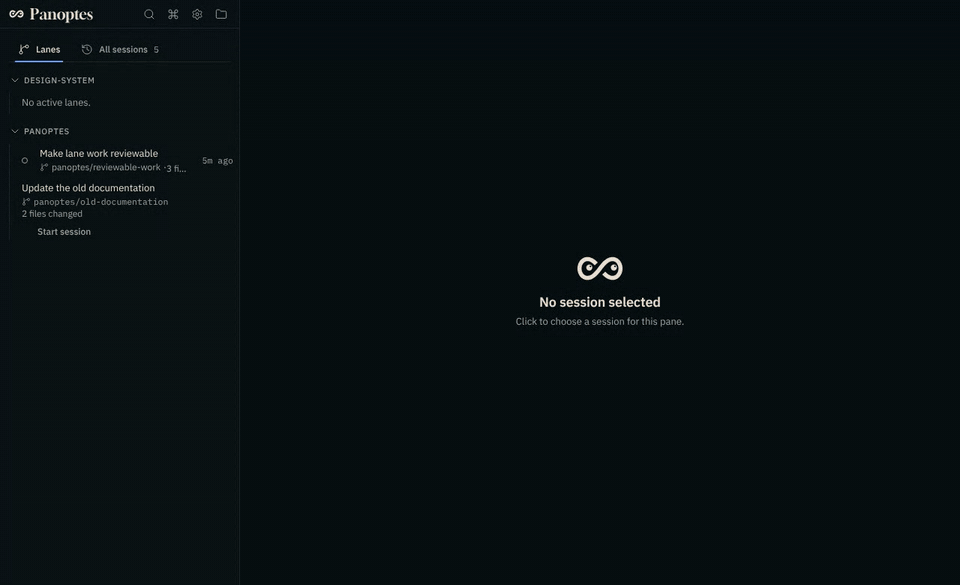
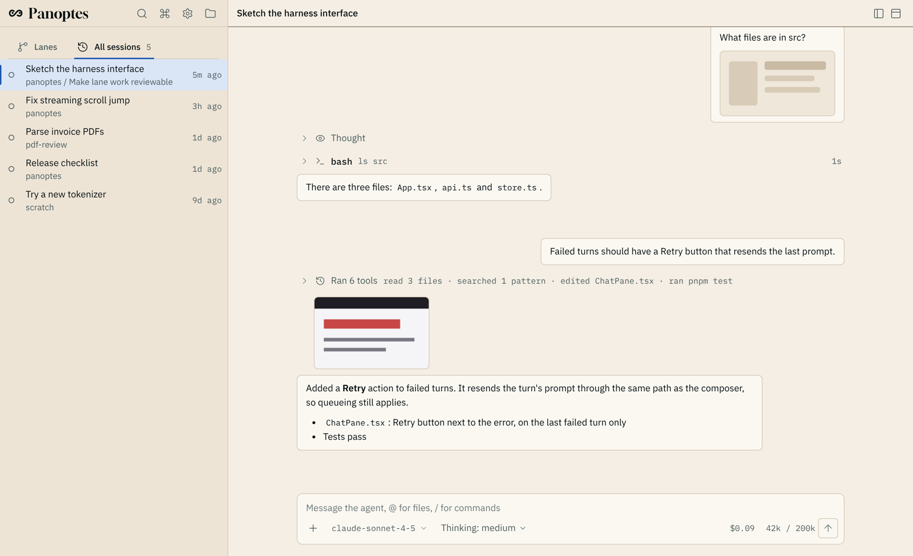

<p align="center">
  <picture>
    <source media="(prefers-color-scheme: dark)" srcset="packages/design-system/assets/logos/panoptes-lockup-bone.svg">
    
  </picture>
</p>

<p align="center">
  <strong>A calm desktop app for watching your coding agent work.</strong><br>
  One git worktree per task, every session in one place, approvals answered in place.
</p>

<p align="center">
  <a href="LICENSE"></a>
  
  <a href="https://github.com/earendil-works/pi"></a>
  
  
</p>

<p align="center">
  
</p>

## Why

Running a coding agent on several tasks at once gets messy fast: a handful of
terminal tabs, agents writing into the same checkout, and no single place to
see what is running, what is waiting on you and what it cost.

Panoptes is a minimal macOS app for the [Pi](https://github.com/earendil-works/pi)
coding agent that **observes and presents the work**. It does not plan,
delegate or coordinate agents. Sessions stay Pi's own files, and lanes are
plain git worktrees and branches, so you can drop back to the terminal at any
time. ([Why it's built this way](docs/decisions.md#observe-pi-do-not-orchestrate-agents).)

## Features

- **Lanes: one task, one worktree.** Start a task from a prompt and Panoptes
  creates a git worktree and branch for it, copies project files and runs
  setup. A lane holds exactly one session, so there is only ever one writer.
- **Every session in one list.** All Pi conversations, including ones you
  started from the terminal, in one reverse-chronological list. Adopt them
  into lanes without copying or rewriting Pi's files. `pi --continue` and
  `/resume` keep working.
- **A live work log.** Replies (as markdown), thinking and tool calls stream
  in. Enter steers the agent, Option+Enter queues a follow-up, Esc stops it.
- **Approvals and questions, answered in place.** Permission prompts and
  questions from Pi extensions (confirm, select, input, editor) appear right
  above the composer.
- **Cost and timing.** Model, tokens, cost and duration for each turn and
  each session.
- **Safe cleanup.** Archive clean lanes. Commit, stash or save dirty work as a
  restorable checkpoint, or delete a lane after a confirmation.
- **No crossed wires.** A lane that another session is editing says so, and
  each open session runs in its own `pi --mode rpc` process, never two on the
  same session.

<table>
  <tr>
    <td></td>
    <td></td>
  </tr>
  <tr>
    <td align="center"><sub>Work log, dark theme</sub></td>
    <td align="center"><sub>All sessions, light theme</sub></td>
  </tr>
</table>

## Quick start

You need macOS 13 or later, [Pi](https://github.com/earendil-works/pi) 1.x
(`pi --version`), and to build it: Rust (via [rustup](https://rustup.rs)),
Node 22+, pnpm and the Xcode Command Line Tools.

```bash
git clone https://github.com/fbrg141/panoptes.git
cd panoptes
pnpm install
pnpm app:install
```

`pnpm app:install` builds a release, signs it ad hoc (no Apple developer
account needed for a build you made yourself), installs it to
`/Applications/Panoptes.app` and opens it. Run it again after `git pull` to
update; it quits a running Panoptes first.

Set `PANOPTES_PI` to use a specific `pi` binary. Apps opened from Finder
don't get your shell's `PATH`, so at startup Panoptes reads it from your
login shell; that is how it finds `pi`, `node` and whatever a project's
setup runs.

There is no prebuilt download yet.

## Status

Panoptes is early and used daily by its author. What's planned next:

- Per-turn checkpoints (#204)
- Nested Pi subagents (#227)

Only Pi is supported today. The UI only ever sees harness-neutral types, so
another agent needs a new adapter crate and nothing else.

## Where your data lives

| | Installed app | `pnpm tauri dev` |
|---|---|---|
| Store | `~/Library/Application Support/dev.panoptes.app/panoptes.db` | `…/dev.panoptes.app/dev/panoptes.db` |
| Lane worktrees | `~/Panoptes/lanes` | `~/Panoptes/dev/lanes` |
| Event log | `…/dev.panoptes.app/logs/YYYY-MM-DD.jsonl` | `…/dev.panoptes.app/dev/logs/` |

The event log is Panoptes' own record for evaluating it in daily use: one
JSON line per session start, close or crash, status change, question asked
or answered, lane change, and error shown in the window. It **never** holds
prompts, replies or file contents, stays on your Mac, and keeps 30 days.
Open it with Help → Show Logs in Finder, or ⌘P → Show logs in Finder.

## Development

```bash
pnpm install
pnpm tauri dev
```

Opening http://localhost:1420 in a normal browser while the dev server runs
shows the UI with fixture data and no agent (`src/dev/mockBackend.ts`). That
is handy for design work, and it's how the screenshots above were made.

```bash
pnpm check   # lint, types, formatting, clippy, all tests
pnpm smoke   # one real round trip with your Pi; fails if the contract broke
```

CI runs the checks in `pnpm check` for every pull request and every push to
`main` (the Rust half on macOS), and a pre-push hook (installed by
`pnpm install`) runs it locally. That suite only talks to a scripted stand-in
for Pi, so run `pnpm smoke` after updating Pi or changing the adapter: it needs
an installed, logged-in Pi and makes one small model call.

### Layout

| Path | What it is |
|---|---|
| `crates/panoptes-harness` | The harness-neutral interface: sessions, messages, events, and the `Harness` / `AgentSession` traits |
| `crates/panoptes-pi` | The Pi adapter: finds `pi`, lists sessions from Pi's session folder, drives `pi --mode rpc` |
| `src-tauri` | The app: `service.rs` (open sessions, event forwarding), `store.rs` (Panoptes' own data in SQLite), exposed as Tauri commands in `lib.rs` |
| `src` | React UI: `conversation.ts` folds events into state, `store.ts` talks to the app, `components/` renders |
| `packages/design-system` | Tokens, fonts, logos, icons and components |

More: [AGENTS.md](AGENTS.md) (contributor and agent guide),
[docs/decisions.md](docs/decisions.md) (design decisions).

## Contributing

Bug reports are very welcome: please
[open an issue](https://github.com/fbrg141/panoptes/issues) with what you did,
what you expected and your Pi version. Feature ideas are collected and
reviewed in batches (see [docs/bets.md](docs/bets.md)), so they may take a
while to get a reply.

## License

[MIT](LICENSE)
