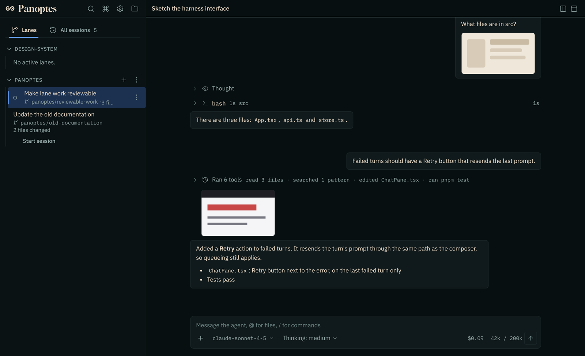

<p align="center">
  <picture>
    <source media="(prefers-color-scheme: dark)" srcset="docs/media/logo-bone.svg">
    
  </picture>
</p>

<p align="center">
  <strong>A calm desktop app for watching your coding agent work.</strong><br>
  One git worktree per task, every session in one place, approvals answered in place.
</p>

<p align="center">
  <a href="LICENSE"></a>
  
  <a href="https://github.com/earendil-works/pi"></a>
  
  
</p>

<p align="center">
  
</p>

## Why

Running a coding agent on several tasks at once gets messy fast: a handful of
terminal tabs, agents writing into the same checkout, and no single place to
see what is running, what is waiting on you and what it cost.

Panoptes is a minimal macOS app for the [Pi](https://github.com/earendil-works/pi)
coding agent that **observes and presents the work**. It does not plan,
delegate or coordinate agents. Sessions stay Pi's own files, and lanes are
plain git worktrees and branches, so you can drop back to the terminal at any
time. ([Why it's built this way](docs/decisions.md#observe-pi-do-not-orchestrate-agents).)

## Features

- **Lanes: one task, one worktree.** Start a task from a prompt and Panoptes
  creates a git worktree and branch for it, copies project files and runs
  setup. A lane keeps earlier sessions but opens only one at a time, so there
  is only ever one writer. Use `/new` for a fresh context and `/resume` for an
  earlier conversation in the same lane.
- **Every session in one list.** All Pi conversations, including ones you
  started from the terminal, in one reverse-chronological list. Adopt them
  into lanes without copying or rewriting Pi's files. `pi --continue` and
  `/resume` keep working.
- **A live work log.** Replies (as markdown), thinking and tool calls stream
  in. Enter steers the agent, Option+Enter queues a follow-up, Esc stops it.
- **Approvals and questions, answered in place.** Permission prompts and
  questions from Pi extensions (confirm, select, input, editor) appear right
  above the composer.
- **Cost and timing.** Model, tokens, cost and duration for each turn and
  each session.
- **Safe cleanup.** Archive clean lanes. Commit, stash or save dirty work as a
  restorable checkpoint, or delete a lane after a confirmation.
- **No crossed wires.** A lane that another session is editing says so, and
  each open session runs in its own `pi --mode rpc` process, never two on the
  same session.

<table>
  <tr>
    <td></td>
    <td></td>
  </tr>
  <tr>
    <td align="center"><sub>Work log, dark theme</sub></td>
    <td align="center"><sub>All sessions, light theme</sub></td>
  </tr>
</table>

## Install

You need macOS 13 or later on an Apple Silicon Mac, and
[Pi](https://github.com/earendil-works/pi) 1.x installed and logged in
(`pi --version`).

### Download

1. Download `Panoptes_<version>_aarch64.dmg` from the
   [latest release](https://github.com/fbrg141/panoptes/releases/latest).
2. Open the .dmg and drag Panoptes to Applications.
3. Open Panoptes. The app is signed ad hoc, not notarized by Apple, so the
   first time macOS says it can't check it for malware. Click Done, then go
   to System Settings → Privacy & Security, scroll to Security and click
   **Open Anyway** next to Panoptes. You only do this once per version.

If you'd rather skip that dialog, clear the download flag in Terminal
instead:

```bash
xattr -dr com.apple.quarantine /Applications/Panoptes.app
```

To update, download the new release and replace the app in Applications.

### Build from source

To build it you also need Rust (via [rustup](https://rustup.rs)) and Xcode
with its Metal toolchain. This works on Intel Macs too.

```bash
git clone https://github.com/fbrg141/panoptes.git
cd panoptes
sh scripts/install-app.sh
```

`scripts/install-app.sh` builds a release, signs it ad hoc, installs it to
`/Applications/Panoptes.app` and opens it. A build you made yourself never
gets the download flag, so macOS doesn't ask. Run it again after `git pull`
to update; it quits a running Panoptes first.

### Finding Pi

Set `PANOPTES_PI` to use a specific `pi` binary. Apps opened from Finder
don't get your shell's `PATH`, so at startup Panoptes reads it from your
login shell; that is how it finds `pi`, `node` and whatever a project's
setup runs.

## Status

Panoptes is early and used daily by its author. What's planned next:

- Per-turn checkpoints (#204)
- Nested Pi subagents (#227)

Only Pi is supported today. The UI only ever sees harness-neutral types, so
another agent needs a new adapter crate and nothing else.

## Where your data lives

| | Installed app | `cargo run -p panoptes-app` |
|---|---|---|
| Store | `~/Library/Application Support/dev.panoptes.app/panoptes.db` | `…/dev.panoptes.app/dev/panoptes.db` |
| Lane worktrees | `~/Panoptes/lanes` | `~/Panoptes/dev/lanes` |
| Event log | `…/dev.panoptes.app/logs/YYYY-MM-DD.jsonl` | `…/dev.panoptes.app/dev/logs/` |

The event log is Panoptes' own record for evaluating it in daily use: one
JSON line per session start, close or crash, status change, question asked
or answered, lane change, and error shown in the window. It **never** holds
prompts, replies or file contents, stays on your Mac, and keeps 30 days.
Open it with Help → Show Logs in Finder, or ⌘P → Show logs in Finder.

## Development

Install [gitleaks](https://github.com/gitleaks/gitleaks) for secret scanning,
then enable the repository's Git hooks:

```bash
brew install gitleaks
git config core.hooksPath .githooks   # once: scan commits and check pushes
cargo run -p panoptes-app
```

A debug build keeps its own store and lanes folder, so it never touches the
installed app's data.

```bash
sh scripts/check.sh   # formatting, clippy, all tests
sh scripts/smoke.sh   # one real round trip with your Pi; fails if the contract broke
```

There is no CI. The pre-commit hook scans staged changes for secrets with
gitleaks, and the pre-push hook runs `scripts/check.sh`. That suite only
talks to a scripted stand-in for Pi, so run `scripts/smoke.sh` after updating
Pi or changing the adapter: it needs an installed, logged-in Pi and makes
one small model call.

### Releasing

Bump the version in the workspace `Cargo.toml`, then on an Apple Silicon Mac
run:

```bash
sh scripts/check.sh
sh scripts/install-app.sh --no-open
sh scripts/make-dmg.sh
```

The install script leaves the ad hoc signed `Panoptes.app` in
`target/release/`, and `make-dmg.sh` packs it into
`target/release/Panoptes_<version>_aarch64.dmg`: a branded window with the
app next to an Applications shortcut. It drives Finder to lay the window
out, so run it from a logged-in desktop session. Before publishing the .dmg, open a downloaded copy once to
check the Open Anyway flow, then attach it to a GitHub release tagged
`v<version>`.

### Layout

| Path | What it is |
|---|---|
| `crates/panoptes-harness` | The harness-neutral interface: sessions, messages, events, and the `Harness` / `AgentSession` traits |
| `crates/panoptes-pi` | The Pi adapter: finds `pi`, lists sessions from Pi's session folder, drives `pi --mode rpc` |
| `crates/panoptes-core` | The backend: `service.rs` (open sessions, event forwarding), `store/` (Panoptes' own data in SQLite), lanes, changes and cleanup |
| `crates/panoptes-app` | The GPUI app: `store.rs` holds its state, `model/` the tested logic, `ds.rs` the design system's components, `views/` renders |

More: [AGENTS.md](AGENTS.md) (contributor and agent guide),
[docs/decisions.md](docs/decisions.md) (design decisions).

## Contributing

Bug reports are very welcome: please
[open an issue](https://github.com/fbrg141/panoptes/issues) with what you did,
what you expected and your Pi version. Feature ideas are collected and
reviewed in batches (see [docs/bets.md](docs/bets.md)), so they may take a
while to get a reply.

## License

[MIT](LICENSE)
