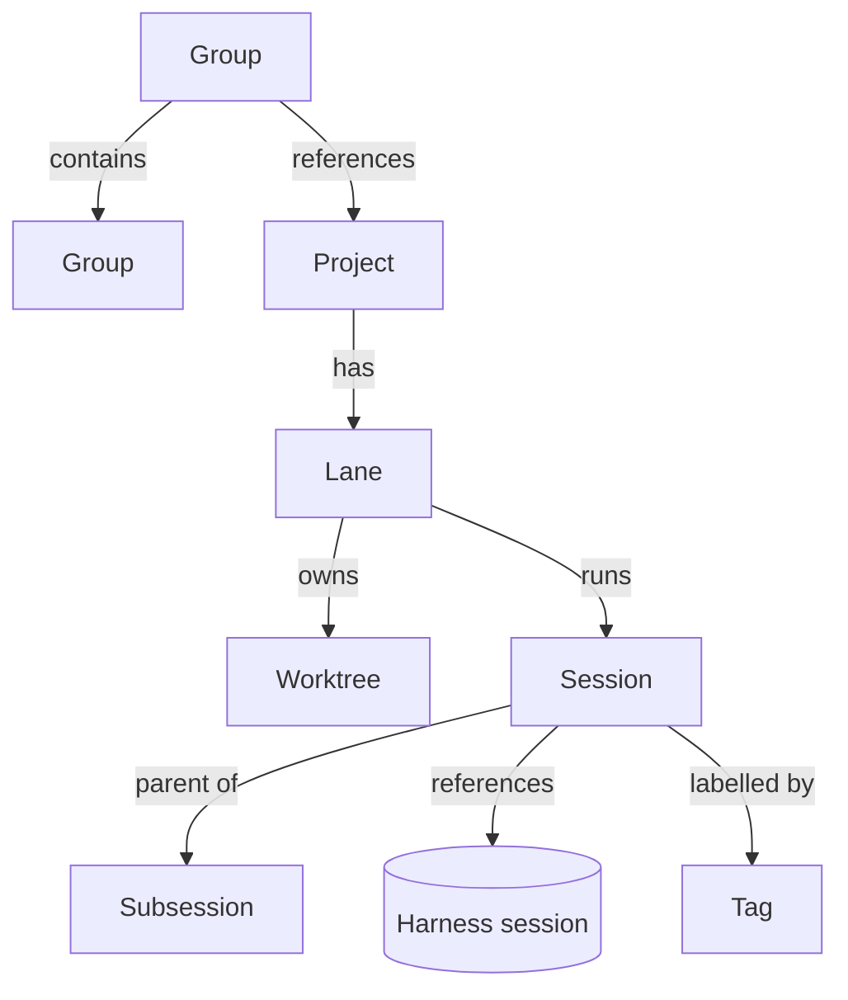

# Domain model

*Proposed 2026-11-06, revised for lanes 2026-11-07. Projects (#19) and
lanes (#20) are built; sessions and groups are not built yet.*

What Panoptes works with, how the pieces relate, and how they live and die.
It answers the "domain model" parts of #8 and #9 and sets up the tool-call
work in #11. The harness contract in `panoptes-harness` stays the boundary
described in [decisions.md](decisions.md); this note adds what sits above it.
Why the model is shaped this way is recorded in
[decisions.md](decisions.md#lanes-are-the-unit-of-work).

## Principles

- **The harness owns the conversation. Panoptes owns the organisation.**
  Messages stay in each harness's own storage (Pi's session files). Projects,
  lanes, groups, titles, tags and archiving live in Panoptes, because they
  must work the same across every harness.
- **The lane is the durable unit; a session is disposable.** A lane owns a
  worktree, a branch, a task and a write lock, and exists with or without a
  session. Closing or replacing a session never touches the lane's work.
- **Decisions live in Rust; the UI only renders.** Lane state, the write
  lock, queueing and what appears where in the sidebar are worked out in the
  core and sent to the UI.
- **Harness-neutral, not protocol-shaped.** The model follows what Panoptes
  needs. It borrows from other protocols where they fit, and copies none.

## Entities

### Project

A local git repository registered in Panoptes. Built in #19.

| Field | Meaning |
|---|---|
| `id` | Panoptes' own id |
| `name` | Display name, defaults to the folder name |
| `repo` | Path of the main checkout |
| `baseBranch` | What new lanes branch from, defaults to the repo's default branch |
| `copyFiles` | Untracked files copied into every new worktree, defaults to `[".env"]` |
| `setup` | Optional command run in a new worktree, such as `pnpm install` |

A project's settings live on the project, never on a group, so a project
behaves the same whichever group it is used from.

### Lane

One line of work on a project: a task, the branch it happens on, the
worktree it happens in, and the lock that decides who may edit it. The name
was chosen over "workspace", which already means something else in VS Code,
Zed and Cargo.

| Field | Meaning |
|---|---|
| `id`, `name` | Panoptes' own id, and a slug used for the folder |
| `project` | The project it belongs to |
| `task` | What the lane is for, in your words |
| `branch` | The branch its worktree is on |
| `worktrees` | For each worktree: project id, path, and whether it is the main checkout |
| `writeLock` | The session that may edit files now, and the queue waiting for it |
| `state` | `active` or `archived` |

- **One worktree, room for more.** The schema lets a lane hold several
  worktrees (one-to-many), so multi-repo lanes (#21) need no migration. The
  service and UI only ever create one for now.
- **A fresh worktree by default.** All lane worktrees live under one central
  folder, `~/Panoptes/lanes/<lane>/<repo>`, on a new
  `panoptes/<lane>` branch. Files listed in `copyFiles` are **copied**, not
  linked, from the main checkout, because git never puts
  untracked files into a new worktree and each worktree may need its own
  values (ports, database names).
- **The main checkout, on purpose.** For big repos where a fresh worktree is
  too slow or too large, a lane can point at the project's own checkout. It
  is an explicit opt-in, marked clearly wherever the lane is shown. Panoptes
  neither creates nor removes that folder.
- **Writes are serialised.** Several sessions can attach to a lane and read
  it, but only the session holding the write lock edits files. The others
  queue and show as Waiting until the lock passes to them. Two agents working
  truly in parallel means two lanes.

### Session

One conversation, run by one harness, inside one lane.

| Field | Meaning |
|---|---|
| `id` | Panoptes' own id, assigned before the harness starts |
| `harnessRef` | Harness name, the harness's session id, and its locator (for Pi, the session file) |
| `lane` | The lane it runs in |
| `parent` | For a subsession, the session that started it |
| `title` | Set by you in Panoptes; when empty, the harness's title or first message |
| `tags`, `pinned`, `archived` | Panoptes' organisation |

- **A Panoptes session is its own record.** It references a harness session
  through `harnessRef` and is never the Pi session itself. Pi sessions stay
  an implementation detail of the adapter.
- **Replaceable.** When a conversation goes stale (its context is full, or it
  went the wrong way), you close it and start a fresh session in the same
  lane, on the same diff. The lane keeps its worktree, branch and task.
- **Subsessions** have their own transcript, share the lane's worktree (and
  its write lock), and hand their result back to the parent. They share no
  history: nothing of the parent's conversation is copied into the child.

**Status** is sent by the backend, not worked out in the UI, using the design
system's words:

| Status | Meaning |
|---|---|
| Running | The agent is working |
| Waiting | The agent needs you (a question or an approval), or it is queued for the lane's write lock |
| Failed | The process ended unexpectedly, or the last run errored |
| Done | Idle and ready for the next prompt |

A session whose process is not running has no status. It is simply closed and
can be reopened.

### Group

A named folder for projects, for example "Panoptes" holding the app and the
design system. Groups come last in the build order (#21).

- Groups nest: a group has at most one parent group, so groups form a tree.
- A group references projects. A project can be referenced by several groups,
  because shared repos (a design system, a common library) are normal.
- A group can't contain itself, directly or through a subgroup.
- A lane started from a group holds one worktree per repo underneath it.

### Tag

A flat label on sessions, for organising work inside a project ("auth",
"bugs"). Tags don't nest; groups are the only hierarchy.

## Navigation

The sidebar splits in two (#57):

- **Projects and lanes** are the primary tree: projects, their active lanes,
  and each lane's sessions, with subsessions under their parent.
- **History** lists every harness session found on disk, including ones
  started from the terminal. You can adopt one into a lane, which creates a
  Panoptes session record that points at it. Adopting never copies or
  rewrites the harness's files.

## Lifecycles

### Lane

1. **Create** from a project. Panoptes adds a worktree on a new branch from
   `baseBranch`, copies `copyFiles` from the main checkout, then runs
   `setup`. With the main-checkout opt-in, none of that happens.
2. If any step fails or you cancel, everything created so far is removed, so
   nothing is left behind (#9).
3. **Use:** sessions come and go inside it. The lane needs none to exist.
4. **Archive**, on request. Archiving never touches the branch.
   - A clean tree: the worktree is removed.
   - A dirty tree never loses work. Panoptes offers three ways out and does
     nothing until you pick one: **commit** the changes on the lane's branch,
     **stash** them onto the branch, or **keep it as a checkpoint**: the tree
     is saved to a checkpoint ref and the worktree is removed, and restoring
     creates a fresh worktree from it (see
     [decisions.md](decisions.md#per-turn-checkpoints-on-plain-git-not-jujutsu)).
   - A main-checkout lane: only the lane record is archived; the checkout is
     left as it is.

### Session

1. **New:** in an existing lane, or in a new lane created for it. The session
   gets its Panoptes id here. The harness process starts on the first
   message (#9).
2. **Open:** one harness process runs it. Each prompt is one run, Running then
   Done (or Waiting, or Failed). A run that needs to edit waits for the
   lane's write lock.
3. **Close or crash:** the process ends and releases the write lock. The
   conversation stays in the harness and the session can be reopened.
4. **Replace:** close it and start a fresh session in the same lane.
5. **Archive:** hidden from the lane. Archiving a session never archives its
   lane.

## Deferred

Left open on purpose, not forgotten:

- **The base branch moving underneath a lane.** Whether Panoptes rebases,
  merges, warns or does nothing is decided once lanes are in real use.
- **Remote or cloud execution.** Lanes and sessions run locally for now. The
  harness adapter boundary keeps a remote runner possible without changing
  the model.

## Storage

The Panoptes store holds projects, lanes, worktrees, sessions, groups and
tags, with several many-to-many links. It is SQLite in the app data folder,
built in #18 (see [decisions.md](decisions.md)); new tables arrive as
migrations.

## Changes to the harness contract

Smaller fixes from the backend review, needed by the model above:

1. **One session identity.** Panoptes' own session id is known before the
   harness reports anything. The service no longer holds early events back
   until the harness id arrives, and the three overlapping shapes
   (`SessionSummary`, `SessionRef`, `SidebarSession`) become one session plus
   its `harnessRef` (#22).
2. **Explicit status.** A `StatusChanged` event from the service, with the
   four statuses above.
3. **Tool calls as one entity.** Done in #24: a `ToolCall` holds its kind,
   subject, input, status and output (text, file edits, or shell output with
   an exit code). The adapter folds results into their calls, live and in
   history, and `ToolCallUpdated` replaces the call in place.
4. **Approvals as their own type.** Done in #25: an `Approval` names its tool
   call and is answered with allow or reject, and puts the session in
   Waiting. Pi has no permission system of its own; its extensions ask
   through dialogs from their `tool_call` hook. Over RPC such a dialog looks
   the same as a question a tool asks while it runs, so Panoptes starts Pi
   with a small extension of its own (`crates/panoptes-pi/src/approvals.js`)
   that tags each confirm or select a `tool_call` hook raises with the call's
   id. The Pi adapter treats a tagged confirm, or a tagged select between one
   allow and one reject option, as the call's approval, and leaves every
   other dialog a question.
5. **Stable message ids and images.** Done in #26: a message keeps the id it
   streamed under while the session is open (the Pi adapter finds each
   history entry's live id by the message's role and timestamp), the harness
   reports its queue with an id per prompt, and image blocks carry their data.
6. **Typed errors.** Errors cross into the UI as plain strings, so it can't
   tell "not open" from "the harness rejected it".

## Effect on existing issues

- **#8:** the lane is the main unit; groups and subgroups are defined above;
  per-worktree `.env` is a copy made at creation. Folder context is still
  open.
- **#9:** the default target is a new lane with a fresh worktree. The main
  checkout is an explicit, marked opt-in.
- **#11:** the tool-call entity and approvals come first.
- **#46:** the write lock answers "sessions sharing a mutation-capable
  worktree", and the archive rules answer "never destroy user work".
  Checkpoints and crash recovery stay with #46.
- **#48:** the product bet is chosen through [bets.md](bets.md).

## Build order

Build the spine fast and solid, not polished; the reason is in
[bets.md](bets.md).

| Step | Issue | Covers |
|---|---|---|
| done | #18 | Versioned Panoptes store |
| done | #19 | Projects and their settings |
| done | #20 | Lanes: create a worktree, archive without losing work, main-checkout opt-in |
| 2 | #22 | Sessions inside a lane: Panoptes identity, write lock and queue, replace |
| 3 | #57 | Split sidebar: projects and lanes, and a History view to adopt from |
| 4 | #58 | Subsessions that hand their result back |
| 5 | #21 | Nested groups and multi-repo lanes, last |

The contract fixes (#23 to #27) can go in any order alongside.

## Open questions

1. **Group context** (#8): instructions a group gives the agents in its
   lanes.
2. **Enforcing the write lock:** gate edit tools through the approvals
   extension, or start sessions without the lock with read-only tools.
3. **Multi-repo context files.** An agent running in a multi-repo lane folder
   does not pick up each repo's `AGENTS.md` on its own. Panoptes may need to
   pass them in.
4. **Sessions outside any project:** a History entry from a folder that isn't
   a registered project. Offer to register it, or adopt it only into a lane
   you pick.
