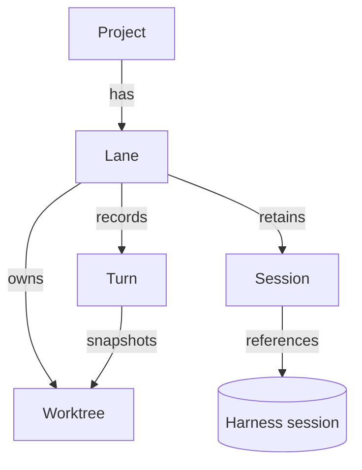

# Domain model

The current Panoptes model: what the app owns, how the pieces relate, and the
rules that protect work. The reasons behind these choices are in
[decisions.md](decisions.md). The proposed product direction is in
[bets.md](bets.md); GitHub issues, milestones and the linked Project own
delivery work and its status, rather than this document.

## Principles

- **The harness owns conversations. Panoptes owns organisation.** Messages stay
  in harness storage. Projects, lanes, session records, tags, profiles and
  preferences live in Panoptes and work through harness-neutral types.
- **The lane is the durable unit.** It retains its worktree, branch, task and
  conversations when any one session closes.
- **Rust owns behaviour; views render.** The service determines lane state,
  membership, lifecycle and session status. Pure app models own testable UI
  state.
- **Missing evidence stays visible.** Failed snapshots, diffs or merge previews
  are unavailable, not silently empty or successful.

## Entities



### Project

A local git repository registered in Panoptes.

| Field | Meaning |
|---|---|
| `id`, `name` | Panoptes identity and display name |
| `repo` | Path of the main checkout |
| `baseBranch` | Base for new lanes, defaulting to the repository's default branch |
| `copyFiles` | Untracked files copied into new worktrees, initially `.env` |
| `setup` | Optional command run in a new worktree |

Project settings belong to the project. Moving between views never changes its
behaviour.

### Lane

One line of work on a project: its task, branch, worktree and session history.

| Field | Meaning |
|---|---|
| `id`, `name` | Panoptes identity and the slug used in generated paths |
| `project` | Owning project |
| `task` | The user's description of the work |
| `branch` | The lane branch |
| `worktrees` | Project id, path and main-checkout flag for each worktree |
| `state` | `active` or `archived` |

The service and UI currently create one worktree per lane. Storage keeps a
one-to-many relationship so the review and checkpoint contracts can use stable
`(lane, project)` worktree identities without assuming paths are unique.

A normal worktree lives at `~/Panoptes/lanes/<lane>/<repo>` on a
`panoptes/<lane>` branch. Debug builds use `~/Panoptes/dev/lanes`. Files in
`copyFiles` are copied rather than linked, allowing each worktree to have its
own local configuration. Their current values are preserved across archive and
restore; other ignored files are not captured.

A lane may explicitly use the project's main checkout instead. Panoptes neither
creates nor removes that checkout, and the choice is visible in the UI.

### Session

One conversation, run by one harness, within a lane's history.

| Field | Meaning |
|---|---|
| `id` | Panoptes identity, assigned before the harness starts |
| `harnessRef` | Harness name, harness session id and adapter-owned locator |
| `lane` | Owning lane |
| `parent` | Parent conversation for a nested harness session, when supported |
| `title` | Panoptes title, falling back to the harness title or first message |
| `tags`, `pinned`, `archived` | Panoptes organisation |

A session record references a harness conversation; it never copies or rewrites
it. A lane retains many records over time but permits only one live writer.
`/new` starts a fresh conversation in the same lane, and `/resume` reopens one
of that lane's earlier records. Opening an earlier record as a preview is
read-only; sending from it stops the live session and resumes the previewed
conversation.

Changing the live session is refused while the agent streams, waits for a
question or approval, or has queued messages. Read-only previews and raw
harness sessions do not take lane checkpoints.

The service, not the UI, determines status:

| Status | Meaning |
|---|---|
| Running | The agent is working |
| Waiting | The agent needs an answer to a question or approval |
| Failed | The process ended unexpectedly or the last run errored |
| Done | Idle and ready for another prompt |

A process that has started but not run is `idle` on the wire and has no status
word. A closed process has no live status; its conversation can be reopened.

### Tag

A flat label on a session. Tags do not form a hierarchy or alter harness
behaviour.

### Profile

A named, reusable setup for a new session. Model, thinking level and additional
instructions are optional; empty fields preserve harness defaults. A new-lane
form applies a profile before its first prompt and permits individual overrides.

Additional instructions are appended to, never substituted for, the harness's
system prompt. They are stored on the session record and restored when its
process resumes. Editing a profile later does not change existing sessions.

### Model preferences

Favourite and hidden model ids are Panoptes presentation preferences. Ordered
favourites lead the model picker; hidden models are omitted from pickers but
remain configured in the harness and valid for existing sessions and profiles.
Neither preference changes harness defaults or CLI behaviour.

## Navigation

The sidebar has two views:

- **Lanes** is a collapsible hierarchy of projects, active lanes and their
  retained sessions. Running or pinned sessions remain in their lane. Archived
  lanes and sessions have expandable archive views.
- **All sessions** is a flat, reverse-chronological list of every harness
  conversation found on disk, including terminal-started conversations and
  those already associated with lanes.

Adopting an unassociated conversation creates a Panoptes session record in an
eligible active lane. It never copies or rewrites the harness file, and lane
membership never relies on guessing from a working directory.

## Lane review

The current review pane is a read-only, lane-wide comparison against each
worktree's merge-base. File lists and lazily loaded hunks come from git trees,
so shell edits and untracked files are included. Active lanes are snapshotted
through private indexes; archived lanes use their checkpoint or clean branch.

Review state is keyed by lane, worktree, path and explicit tree range.
Generation-checked responses prevent stale asynchronous results from replacing
newer state. The pane follows the focused session, supports stable file and
hunk navigation, and refreshes after a run settles.

Each worktree also reports base freshness and a read-only merge preview: clean,
named conflicts or unavailable. The preview uses the local base without
fetching or merging into the real worktree. Later review scopes and actions are
tracked under #201.

## Turn checkpoints

Every writable prompt-driven lane run has a lane-level turn and one snapshot
record per worktree. Turn checkpoints were added in schema v13. Each turn stores
its session, short prompt label, outcome and timestamps. Each worktree row stores
deterministic before/after refs, tree ids, boundary quality, human-edit
detection, recovery state and errors.

```text
LaneTurn
├── session id, prompt label, outcome
└── WorktreeTurn[]
    ├── project id and deterministic before/after refs
    ├── before/after trees and parent chain
    ├── exact | observed | unavailable boundary
    └── human edits, recovery and errors
```

An immediate prompt takes its before snapshot before the harness receives it. A
queued prompt reserves intent, then refreshes its boundary on its actual
`RunStarted` and marks it observed. Steering creates no turn. Human edits are
detected by comparing a new before tree with the previous after tree.

Settled, stopped, failed and exited runs share an idempotent after path. A late
event from a replaced process cannot settle a newer turn. Startup adopts valid
generated refs, snapshots readable worktrees, uses archive checkpoints where
available, marks unrecoverable state unavailable, and removes only generated
orphan refs.

Snapshots use private indexes and generated refs. They do not change HEAD, the
lane branch, real index, stash or config. Large files are retained, ignored
files remain excluded, and unsafe nested repositories fail explicitly.

## Lifecycles

### Lane

1. **Create:** the project `+` action takes a prompt, prepares a worktree or
   uses the explicit main-checkout option, applies copy/setup settings, creates
   the first session and sends the prompt.
2. **Use:** close and reopen the current conversation, start a fresh one with
   `/new`, or resume an earlier one with `/resume`.
3. **Archive:** close the live session and preserve work according to the tree:
   - A clean worktree is removed; its branch remains.
   - Dirty work is committed, stashed or saved as a checkpoint before removal.
     Restoring a checkpoint recreates the worktree with uncommitted changes.
   - A main-checkout lane archives only its Panoptes record.
   - Current `copyFiles` values are saved under the lane's generated refs and
     restored without staging. Other ignored files may be lost with removal.
4. **Restore:** recreate an archived worktree and restore its configured files
   and checkpoint where present.
5. **Delete:** after confirmation, close sessions and permanently remove the
   worktree, local branch, generated recovery refs and Panoptes records as
   applicable. Harness conversations are never deleted. A main-checkout lane
   deletes only its Panoptes records.

### Session

1. **New:** created with its lane, through `/new`, or by adoption. Its Panoptes
   id exists before harness events arrive.
2. **Open:** one harness process owns the live conversation. Each prompt runs
   through Running to Done, Waiting or Failed.
3. **Close or crash:** the process ends; harness history and the Panoptes record
   remain. The session can be reopened, while an archived lane is read-only.
4. **Archive:** hides the session from the lane without archiving the lane or
   permitting another live writer.

## Storage and harness limits

Panoptes stores projects, lanes, worktrees, session records, turns, tags,
profiles and preferences in SQLite. Schema changes are append-only migrations;
installed and debug builds use separate stores and lane roots.

Pi's RPC protocol cannot list sessions. `panoptes-pi` therefore reads Pi's
session folder behind `Harness::list_sessions`. This is an adapter-owned
compatibility risk and can be replaced if Pi adds an RPC listing command.

Panoptes currently runs locally. It does not automatically rebase or merge a
lane when its base branch advances; it reports freshness and a merge preview.
Remote execution and automatic base-branch integration remain undecided.

Project groups, group-level sessions, project-level sessions outside a lane,
and multi-repository lane creation are not current behaviour. They belong to
the third proposed product track, which needs a deliberate decision at #226
and explicit per-repository boundaries before implementation. Harness-owned
subagent visibility, if introduced, remains read-only and adds no independent
Panoptes-owned conversation or worktree lifecycle.
