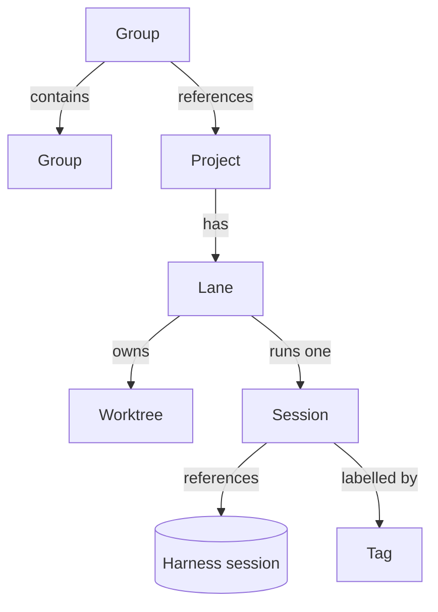

# Domain model

*Proposed 2026-11-06, revised for one session per lane 2026-11-11 (#228).
Projects (#19), lanes (#20) and their sessions are built; groups are not.*

What Panoptes works with, how the pieces relate, and how they live and die.
It answers the "domain model" parts of #8 and #9 and sets up the tool-call
work in #11. The harness contract in `panoptes-harness` stays the boundary
described in [decisions.md](decisions.md); this note adds what sits above it.
Why the model is shaped this way is recorded in
[decisions.md](decisions.md#lanes-are-the-unit-of-work).

## Principles

- **The harness owns the conversation. Panoptes owns the organisation.**
  Messages stay in each harness's own storage (Pi's session files). Projects,
  lanes, groups, titles, tags and archiving live in Panoptes, because they
  must work the same across every harness.
- **The lane is the durable unit with one session.** A lane owns a worktree,
  a branch, a task and exactly one session. Closing that session never touches
  the lane's work; reopening resumes the same conversation. A new task is a new
  lane, not a replacement session on the old one.
- **Decisions live in Rust; the UI only renders.** Lane state, session
  membership and what appears where in the sidebar are worked out in the core
  and sent to the UI.
- **Harness-neutral, not protocol-shaped.** The model follows what Panoptes
  needs. It borrows from other protocols where they fit, and copies none.

## Entities

### Project

A local git repository registered in Panoptes. Built in #19.

| Field | Meaning |
|---|---|
| `id` | Panoptes' own id |
| `name` | Display name, defaults to the folder name |
| `repo` | Path of the main checkout |
| `baseBranch` | What new lanes branch from, defaults to the repo's default branch |
| `copyFiles` | Untracked files copied into every new worktree, defaults to `[".env"]` |
| `setup` | Optional command run in a new worktree, such as `pnpm install` |

A project's settings live on the project, never on a group, so a project
behaves the same whichever group it is used from.

### Lane

One line of work on a project: a task, the branch it happens on, the
worktree it happens in, and its one session. The name was chosen over
"workspace", which already means something else in VS Code, Zed and Cargo.

| Field | Meaning |
|---|---|
| `id`, `name` | Panoptes' own id, and a slug used for the folder |
| `project` | The project it belongs to |
| `task` | What the lane is for, in your words |
| `branch` | The branch its worktree is on |
| `worktrees` | For each worktree: project id, path, and whether it is the main checkout |
| `state` | `active` or `archived` |

- **One worktree, room for more.** The schema lets a lane hold several
  worktrees (one-to-many), so multi-repo lanes (#21) need no migration. The
  service and UI only ever create one for now.
- **A fresh worktree by default.** All lane worktrees live under one central
  folder, `~/Panoptes/lanes/<lane>/<repo>`, on a new
  `panoptes/<lane>` branch. Files listed in `copyFiles` are **copied**, not
  linked, from the main checkout, because git never puts
  untracked files into a new worktree and each worktree may need its own
  values (ports, database names). Their current lane values are preserved
  across archive and restore, rather than copied back from the main checkout.
- **The main checkout, on purpose.** For big repos where a fresh worktree is
  too slow or too large, a lane can point at the project's own checkout. It
  is an explicit opt-in, marked clearly wherever the lane is shown. Panoptes
  neither creates nor removes that folder.
- **One session, one writer.** The store refuses a second session record for
  a lane, including after the first is archived. There is no write lock,
  read-only non-holder session or lock queue. Parallel work means separate
  lanes.

### Session

One conversation, run by one harness, inside one lane.

| Field | Meaning |
|---|---|
| `id` | Panoptes' own id, assigned before the harness starts |
| `harnessRef` | Harness name, the harness's session id, and its locator (for Pi, the session file) |
| `lane` | The lane it runs in |
| `parent` | For a nested Pi subagent, its parent conversation; not a Panoptes subsession |
| `title` | Set by you in Panoptes; when empty, the harness's title or first message |
| `tags`, `pinned`, `archived` | Panoptes' organisation |

- **A Panoptes session is its own record.** It references a harness session
  through `harnessRef` and is never the Pi session itself. Pi sessions stay
  an implementation detail of the adapter.
- **One conversation per lane.** Close and reopen the same session rather
  than replacing it. A stale conversation can be discarded; a new task gets a
  new lane.
- **Pi subagents, when exposed (#227),** will appear nested under this session
  as read-only activity owned by Pi. They are not additional Panoptes sessions
  and have no composer or independent lifecycle.

**Status** is sent by the backend, not worked out in the UI, using the design
system's words:

| Status | Meaning |
|---|---|
| Running | The agent is working |
| Waiting | The agent needs you (a question or an approval) |
| Failed | The process ended unexpectedly, or the last run errored |
| Done | Idle and ready for the next prompt |

A session whose process is not running has no status. It is simply closed and
can be reopened.

### Group

A named folder for projects, for example "Panoptes" holding the app and the
design system. Groups come last in the build order (#21).

- Groups nest: a group has at most one parent group, so groups form a tree.
- A group references projects. A project can be referenced by several groups,
  because shared repos (a design system, a common library) are normal.
- A group can't contain itself, directly or through a subgroup.
- A lane started from a group holds one worktree per repo underneath it.

### Tag

A flat label on sessions, for organising work inside a project ("auth",
"bugs"). Tags don't nest; groups are the only hierarchy.

## Navigation

The sidebar has two tabs (#57):

- **Lanes** is the primary, collapsible hierarchy: projects, their active
  lanes, and each lane's one session. Pi subagents will nest under that
  session when #227 lands. Sessions stay in their lane while running or pinned;
  there are no separate Open or Pinned sections. Archived lanes and sessions
  have expandable archive views.
- **All sessions** is one flat, reverse-chronological list of every harness
  session found on disk, including ones started from the terminal and ones
  already shown under Lanes. You can adopt an unassociated conversation into
  an active lane that has no session, which creates its one Panoptes session
  record. Adoption never copies or rewrites the harness's files. Lane
  membership comes from these records, never from a cwd guess.

A session can still change another lane's worktree. Those writes are
recorded from tool calls and worktree fingerprints, and shown as links: the
written lane names the writer, the writer's lane lists what it also edited,
and each active lane shows its uncommitted files and commits ahead. A lane
with no session reads as not started, holding work (Continue in this lane,
with an editable brief), or being changed by another session that is still
running, which holds back a second writer. See
[decisions.md](decisions.md#work-in-another-lane-is-shown-not-reorganised).

## Lifecycles

### Lane

1. **Create from a project `+` and a prompt.** Panoptes adds a worktree on a
   new branch from `baseBranch`, copies `copyFiles` from the main checkout,
   runs `setup`, then creates the lane's one session and sends the prompt.
   With the main-checkout opt-in, it uses the project's checkout instead.
2. If worktree setup fails or you cancel, everything created so far is removed,
   so nothing is left behind (#9). If session startup fails, its record is
   discarded and the empty lane offers a retry.
3. **Use:** close and reopen the lane's one session as needed.
4. **Archive**, on request. Archiving never touches the branch.
   - A clean tree: the worktree is removed.
   - A dirty tree never loses work. Panoptes offers three ways out and does
     nothing until you pick one: **commit** the changes on the lane's branch,
     **stash** them onto the branch, or **keep it as a checkpoint**: the tree
     is saved to a checkpoint ref and the worktree is removed, and restoring
     creates a fresh worktree from it (see
     [decisions.md](decisions.md#per-turn-checkpoints-on-plain-git-not-jujutsu)).
   - A main-checkout lane: only the lane record is archived; the checkout is
     left as it is.
   - Before any worktree is removed, the current contents of `copyFiles` are
     saved under `refs/panoptes/lanes/<lane>/copy-files`. Restore writes them
     back without staging them, before the normal copy and setup steps.
   - Other ignored files are not captured and may be deleted with the
     worktree. Local state that must survive archive belongs in `copyFiles`.
   - **Delete**, after explicit confirmation, is separate from archive. Close
     the lane's session first. Deleting a worktree lane permanently removes
     its worktree (including uncommitted changes), local branch and recovery
     refs, then its lane and Panoptes session records. A main-checkout lane
     deletes only those records. Harness conversation files are never
     deleted. Once its last lane is deleted, the project can be removed.

### Session

1. **New:** created with its lane from the project `+` prompt, or adopted into
   an empty active lane. The session gets its Panoptes id before the harness
   starts, so every event it sends carries that id.
2. **Open:** one harness process runs it. Each prompt is one run, Running then
   Done (or Waiting, or Failed). The lane has no write lock or queue.
3. **Close or crash:** the process ends. The conversation stays in the harness
   and the same session can be reopened; archived lanes reopen it read-only.
4. **Archive:** hidden from the lane. Archiving a session never archives its
   lane and does not permit a second session to replace it.

## Deferred

Left open on purpose, not forgotten:

- **The base branch moving underneath a lane.** Whether Panoptes rebases,
  merges, warns or does nothing is decided once lanes are in real use.
- **Remote or cloud execution.** Lanes and sessions run locally for now. The
  harness adapter boundary keeps a remote runner possible without changing
  the model.

## Storage

The Panoptes store holds projects, lanes, worktrees, sessions, groups and
tags, with several many-to-many links. It is SQLite in the app data folder,
built in #18 (see [decisions.md](decisions.md)); new tables arrive as
migrations.

## Changes to the harness contract

Smaller fixes from the backend review, needed by the model above:

1. **One session identity.** Panoptes' own session id is known before the
   harness reports anything. The service no longer holds early events back
   until the harness id arrives, and the three overlapping shapes
   (`SessionSummary`, `SessionRef`, `SidebarSession`) become one session plus
   its `harnessRef` (#22).
2. **Explicit status.** A `StatusChanged` event from the service, with the
   four statuses above.
3. **Tool calls as one entity.** Done in #24: a `ToolCall` holds its kind,
   subject, input, status and output (text, file edits, or shell output with
   an exit code). The adapter folds results into their calls, live and in
   history, and `ToolCallUpdated` replaces the call in place.
4. **Approvals as their own type.** Done in #25: an `Approval` names its tool
   call and is answered with allow or reject, and puts the session in
   Waiting. Pi has no permission system of its own; its extensions ask
   through dialogs from their `tool_call` hook. Over RPC such a dialog looks
   the same as a question a tool asks while it runs, so Panoptes starts Pi
   with a small extension of its own (`crates/panoptes-pi/src/approvals.js`)
   that tags each confirm or select a `tool_call` hook raises with the call's
   id. The Pi adapter treats a tagged confirm, or a tagged select between one
   allow and one reject option, as the call's approval, and leaves every
   other dialog a question.
5. **Stable message ids and images.** Done in #26: a message keeps the id it
   streamed under while the session is open (the Pi adapter finds each
   history entry's live id by the message's role and timestamp), the harness
   reports its queue with an id per prompt, and image blocks carry their data.
6. **Typed errors.** Errors cross into the UI as plain strings, so it can't
   tell "not open" from "the harness rejected it".

## Effect on existing issues

- **#8:** the lane is the main unit; groups and subgroups are defined above;
  per-worktree `.env` is a copy made at creation. Folder context is still
  open.
- **#9:** the default target is a new lane with a fresh worktree. The main
  checkout is an explicit, marked opt-in.
- **#11:** the tool-call entity and approvals come first.
- **#46:** one session per lane answers who may write in a worktree, and the
  archive rules answer "never destroy user work". Checkpoints and crash
  recovery stay with #46.
- **#48:** the product bet is chosen through [bets.md](bets.md).

## Build order

Build the spine fast and solid, not polished; the reason is in
[bets.md](bets.md).

| Step | Issue | Covers |
|---|---|---|
| done | #18 | Versioned Panoptes store |
| done | #19 | Projects and their settings |
| done | #20 | Lanes: create a worktree, archive without losing work, main-checkout opt-in |
| done | #22 | Sessions inside a lane: Panoptes identity; lock model superseded by #228 |
| done | #57 | Collapsible Lanes hierarchy, flat All sessions list and adoption |
| done | #228 | One session per lane, prompt-based creation, no lock or replacement |
| dropped | #58 | Panoptes-owned subsessions; Pi subagent observation moves to #227 |
| dropped | #21 | Nested groups and multi-repo lanes |

The contract fixes (#23 to #27) can go in any order alongside.

## Open questions

1. **Group context** (#8): instructions a group gives the agents in its
   lanes.
2. **Multi-repo context files.** An agent running in a multi-repo lane folder
   does not pick up each repo's `AGENTS.md` on its own. Panoptes may need to
   pass them in.
