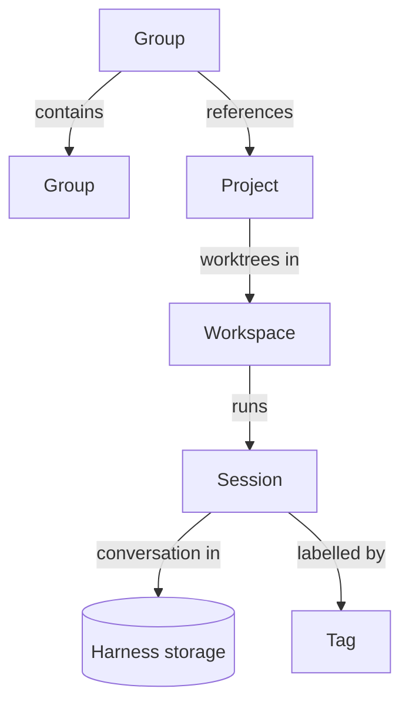

# Domain model

*Proposed 2026-11-06. Nothing here is built yet.*

What Panoptes works with, how the pieces relate, and how they live and die.
It answers the "domain model" parts of #8 and #9 and sets up the tool-call
work in #11. The harness contract in `panoptes-harness` stays the boundary
described in [decisions.md](decisions.md); this note adds what sits above it.

## Principles

- **The harness owns the conversation. Panoptes owns the organisation.**
  Messages stay in each harness's own storage (Pi's session files). Projects,
  groups, workspaces, titles, tags and archiving live in Panoptes, because
  they must work the same across every harness.
- **The worktree is the main unit.** By default every new session gets its
  own worktree, so agents running side by side never edit the same files.
- **Harness-neutral, not protocol-shaped.** The model follows what Panoptes
  needs. It borrows from other protocols where they fit, and copies none.

## Entities

### Project

A local git repository registered in Panoptes.

| Field | Meaning |
|---|---|
| `id` | Panoptes' own id |
| `name` | Display name, defaults to the folder name |
| `repo` | Path of the main checkout |
| `baseBranch` | What new worktrees branch from, defaults to the repo's default branch |
| `copyFiles` | Untracked files copied into every new worktree, defaults to `[".env"]` |
| `setup` | Optional command run in a new worktree, such as `pnpm install` |

A project's settings live on the project, never on a group, so a project
behaves the same whichever group it is used from.

### Group

A named folder for projects, for example "Panoptes" holding the app and the
design system.

- Groups nest: a group has at most one parent group, so groups form a tree.
- A group references projects. A project can be referenced by several groups,
  because shared repos (a design system, a common library) are normal.
- A group can't contain itself, directly or through a subgroup.
- A group is also how you start a session across several repos (see
  [Workspace](#workspace)).

### Workspace

The one folder an agent runs in, made of worktrees. All workspaces live under
one central folder, `~/Panoptes/workspaces/<workspace>/`, with one worktree per
repo at `<workspace>/<repo>`.

| Field | Meaning |
|---|---|
| `id`, `name` | Panoptes' own id, and a slug used for the folder |
| `origin` | The project or group it was created from |
| `checkouts` | For each repo: project id, worktree path, branch |
| `state` | `active` or `archived` |

- **One repo:** the agent runs in the worktree itself.
- **A group:** the agent runs in the workspace folder, with the repos side by
  side underneath it.
- **Main checkout:** for quick questions, a session can run in a project's own
  repo folder instead. Panoptes neither creates nor removes that folder.

Files listed in `copyFiles` are **copied**, not linked, from the main checkout
when the worktree is made. Git never puts untracked files into a new worktree,
and each worktree may need its own values (ports, database names).

### Session

One conversation, run by one harness, in one workspace.

| Field | Meaning |
|---|---|
| `id` | Panoptes' own id, assigned before the harness starts |
| `harnessRef` | Harness name, the harness's session id, and its locator (for Pi, the session file) |
| `workspace` | The workspace it runs in |
| `origin` | The group or project it was started from, which decides where it shows in the sidebar |
| `title` | Set by you in Panoptes; when empty, the harness's title or first message |
| `tags`, `pinned`, `archived` | Panoptes' organisation |

- A workspace can hold several sessions, for example a fresh session that
  continues a task once the first one's context is full.
- A session shows in the sidebar only under its `origin`, even when its repos
  appear in other groups too.
- Sessions started outside Panoptes (Pi in a terminal) still appear. They get
  a session record the first time they are listed, matched to a workspace or
  project by their folder.

**Status** is sent by the backend, not worked out in the UI, using the design
system's words:

| Status | Meaning |
|---|---|
| Running | The agent is working |
| Waiting | The agent needs you: a question or an approval |
| Failed | The process ended unexpectedly, or the last run errored |
| Done | Idle and ready for the next prompt |

A session whose process is not running has no status. It is simply closed and
can be reopened.

### Tag

A flat label on sessions, for organising work inside a project ("auth",
"bugs"). Tags don't nest; groups are the only hierarchy.

## Lifecycles

### Workspace

1. **Create**, from a project or a group. From a group, every repo underneath
   it is offered, without duplicates, and you untick the ones you don't need.
   For each repo, Panoptes adds a worktree on a new branch from `baseBranch`,
   copies `copyFiles` from the main checkout, then runs `setup`.
2. If any step fails or you cancel, everything created so far is removed, so
   nothing is left behind (#9).
3. **Use:** one or more sessions run in it.
4. **Archive**, when its last session is archived or on request: the worktrees
   are removed and the branches kept.

### Session

1. **New:** pick a target. By default that is a new workspace from the current
   project or group; an existing workspace and the main checkout are the
   alternatives. The session gets its Panoptes id here. The harness process
   starts on the first message (#9).
2. **Open:** one harness process runs it. Each prompt is one run, Running then
   Done (or Waiting, or Failed).
3. **Close or crash:** the process ends. The conversation stays in the harness
   and the session can be reopened.
4. **Archive:** hidden from the sidebar. If it was the workspace's last active
   session, the workspace is archived too.

## Storage

The Panoptes store replaces `index.json`. It now holds real data: projects,
groups, workspaces, sessions and tags, with several many-to-many links. It
needs a schema version, migrations, and must never silently drop data the way
a corrupt `index.json` was read as empty. It is SQLite in the app data folder,
built in #18 (see [decisions.md](decisions.md)); today's pins migrate into it
once.

## Changes to the harness contract

Smaller fixes from the backend review, needed by the model above:

1. **One session identity.** Panoptes' own session id is known before the
   harness reports anything. The service no longer holds early events back
   until the harness id arrives, and the three overlapping shapes
   (`SessionSummary`, `SessionRef`, `SidebarSession`) become one session plus
   its `harnessRef`.
2. **Explicit status.** A `StatusChanged` event from the service, with the
   four statuses above.
3. **Tool calls as one entity.** Done in #24: a `ToolCall` holds its kind,
   subject, input, status and output (text, file edits, or shell output with
   an exit code). The adapter folds results into their calls, live and in
   history, and `ToolCallUpdated` replaces the call in place.
4. **Approvals as their own type.** Done in #25: an `Approval` names its tool
   call and is answered with allow or reject, and puts the session in
   Waiting. Pi has no permission system of its own; its extensions ask
   through dialogs from their `tool_call` hook, which runs after Pi reports
   the call started and before it runs. The Pi adapter treats a confirm, or a
   select between one allow and one reject option, that arrives in that gap
   as the call's approval, and leaves every other dialog a question.
5. **Stable message ids and images.** Streamed messages use temporary ids that
   are swapped after the run, and queued prompts are matched to messages by
   their text. Image blocks keep only their type, so history can't show them.
6. **Typed errors.** Errors cross into the UI as plain strings, so it can't
   tell "not open" from "the harness rejected it".

## Effect on existing issues

- **#8:** the worktree is the main unit; groups and subgroups are defined
  above; per-worktree `.env` is a copy made at creation, replacing the
  "override the project default" idea. Folder context is still open.
- **#9:** the default target becomes a new workspace, which reverses that
  issue's open question 3. The main checkout is the quick option.
- **#11:** the tool-call entity and approvals come first.

## Tracking

In a workable order. The first four build the model; the rest fix the
contract and can go in any order.

| Issue | Covers |
|---|---|
| #18 | Versioned Panoptes store |
| #19 | Projects and their settings |
| #20 | Workspaces: a worktree per session |
| #21 | Nested groups and multi-repo sessions |
| #22 | Session identity, titles, tags and archiving |
| #23 | Status from the backend |
| #24 | Tool calls as one entity |
| #25 | Approvals |
| #26 | Stable message ids and images |
| #27 | Typed errors |

## Open questions

1. **Group context** (#8): instructions a group gives the agents in its
   sessions.
2. **Branch names** for new worktrees, for example `panoptes/<workspace>`.
3. **Multi-repo context files.** An agent running in the workspace folder does
   not pick up each repo's `AGENTS.md` on its own. Panoptes may need to pass
   them in.
4. **Archiving with uncommitted changes:** refuse, warn, or keep the worktree.
5. **Sessions outside any project:** a session started in a folder that isn't
   a registered project. Offer to register it, or list it under "Other".
6. **The central folder:** fixed at `~/Panoptes/workspaces` or set in
   Settings.
